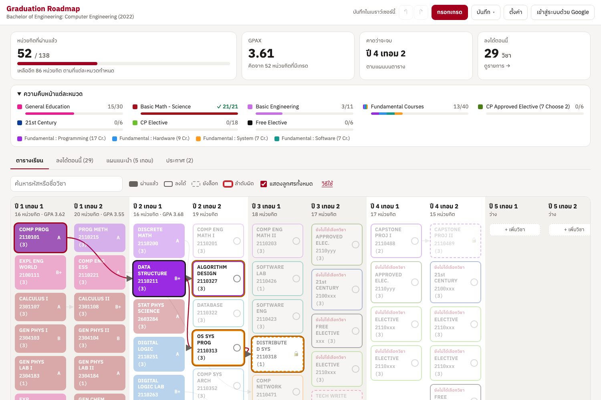
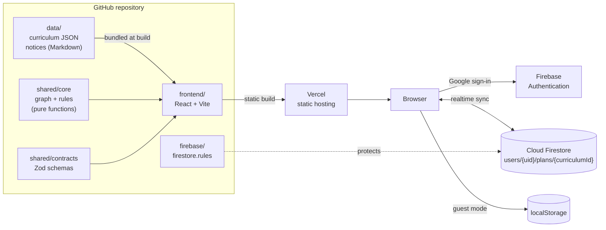

# CompEngChula Graduation Roadmap

**Plan your Computer Engineering degree at Chulalongkorn University and check every graduation requirement in one view.**


[**Open the app →**](https://graduationchecklist.vercel.app/)


## What it is

The app shows the CP curriculum (B.Eng. Computer Engineering, 2022 / B.E. 2566) as a board: 10 semester columns with one card per course. It treats the curriculum as a graph. Courses are nodes and prerequisites are edges, so the app can tell you:

- what you can register for now
- what each course unlocks
- what breaks if you move or fail a course
- whether you meet the graduation requirements yet

It needs no account. Sign in with Google if you want your plan saved to the cloud and synced across devices.



## Features

- **Drag-and-drop planning.** Move courses between semesters. Dependent courses shift along with them, and the board refuses semesters where a course is not offered.
- **Prerequisite map.** Hover or tap a course to highlight what it needs (red) and what it unlocks (orange). Arrows show the whole chain.
- **Credit check by category.** Progress bars for each category (GenEd, Math & Science, Core, Electives…). Surplus credits in one category never hide a gap in another.
- **Grades and GPAX.** Enter grades course by course, or paste a whole transcript at once. The app shows GPA per term and an overall GPAX.
- **Graduation and honours status.** When every category is complete, the app says you can graduate and checks honours:
  - first-class: GPAX ≥ 3.60
  - second-class: GPAX ≥ 3.25
  - both also require finishing within 4 years with no F or U
- **Electives and GenEd.**
  - Pick electives from the official lists, or type in any course yourself.
  - Self-chosen GenEd courses have their own row under the board, each with its own term picker.
- **Auto-plan.** Suggests a semester-by-semester plan for the remaining courses. It respects prerequisites, the terms each course is offered and the credit limit per term.
- **Cloud sync.** Sign in with Google to save your plan. Changes appear on your other devices in real time and survive going offline.
- **Export.** Save the board as a PNG or a landscape PDF, or download a JSON backup.
- **Thai UI, light and dark themes, mobile friendly.**

## How to use the app

1. **Open** [graduationchecklist.vercel.app](https://graduationchecklist.vercel.app/). Every course starts in the semester the official plan suggests.
2. **Mark what you have passed.** Click the circle on the right of a card, or click the course name and choose a grade. To enter many grades at once, use **กรอกเกรด** (enter grades) and paste lines in either of these formats:
   - `2110101 A`
   - `{"2110101","A"}`
3. **Fill in your electives.** Click any card that says **ยังไม่ได้เลือกวิชา** ("no course chosen yet") and pick a course or type one in. For GenEd, use the row below the board: click a card, type the course, then choose the term under it.
4. **Plan ahead.** Drag cards to the semesters you intend to take them. On mobile, long-press a card before dragging it. Watch the credit total in each column header.
5. **Check your status.** The summary at the top shows the following. When everything is complete, it shows **จบได้** (ready to graduate) and your honours level.
   - credits remaining
   - GPAX
   - your expected graduation term
   - how many courses you can take now
6. **Save it.**
   - Without signing in, the plan stays in this browser.
   - Click **เข้าสู่ระบบด้วย Google** (sign in with Google) to keep it in your account. Any plan you already made in the browser moves into your account.
   - **บันทึก** (save) exports a PNG, a PDF or a backup file.

> Course data was transcribed from the official curriculum diagram. Always confirm with the official documents and your faculty before you register.

## Tech stack

| Layer | Tools |
|---|---|
| Frontend | React 19, TypeScript, Vite, Zustand (state and undo), dnd-kit (drag and drop), react-markdown (notices) |
| Domain logic | `@cp/core`: pure TypeScript functions for graph algorithms (topological sort, prerequisite chains), credit rules, grades and the planner |
| Data contracts | Zod schemas that validate the curriculum file, saved plans and backups |
| Auth and database | Firebase Authentication (Google sign-in) and Cloud Firestore with offline persistence |
| Hosting | Vercel (static build). The legacy site on GitHub Pages now only helps old users move their data. |
| Quality | Vitest (unit), Playwright (end-to-end, including against the Firebase Emulator), Biome (lint and format), GitHub Actions CI |

### Architecture



- **There is no backend server of our own.** The site is fully static, and Firebase handles login and storage.
- **All the logic runs in the browser.** The curriculum and the planning rules ship with the site, so the board works offline and only plan data goes over the network.
- **Access control lives in [`firebase/firestore.rules`](firebase/firestore.rules).** Each user can read and write only their own plans.
- **Saving is quick and cheap.**
  - Edits are saved 0.8 s after you stop editing, so rapid clicks count as one write.
  - Firestore keeps the edit locally until it reaches the server.
  - Other open devices update immediately.

## Development

You need Node 24 or later.

```bash
corepack enable      # once, so the pinned pnpm version is used
pnpm install
pnpm dev             # http://localhost:5173
```

To try accounts without a real Firebase project, use the emulator (requires Java 21+):

```bash
pnpm dev:emulator    # Firebase Emulator (fake Google sign-in + local Firestore) + the site
```

| Command | What it does |
|---|---|
| `pnpm test` | Unit tests for `core` and `contracts`, including checks on the curriculum file |
| `pnpm test:e2e` | Browser tests with Playwright. The first time, run `pnpm --filter @cp/web exec playwright install chromium`. |
| `pnpm test:e2e:firebase` | Browser tests against the Firebase Emulator: accounts, sync and security rules |
| `pnpm typecheck` | TypeScript check |
| `pnpm lint` / `pnpm format` | Biome lint / auto-format |
| `pnpm build` | Production build into `frontend/dist` |
| `pnpm checklist --why 2110327` | Python version of the checker (see `learning/`) |

Deployment and Firebase setup are covered step by step in [docs/deploy.md](docs/deploy.md).

### Project structure

```text
data/               Curriculum and notices. Edit these files to update the site.
  index.json          List of curricula and their notices
  comp-eng-2566.json  Courses, categories, prerequisites, elective pools
  notices/            Announcements written in Markdown
frontend/           React app
  src/features/       One folder per area: board, summary, grades, planner, account, export…
  src/stores/         planStore (plan, undo, saving) and uiStore (screen state)
  src/lib/            Firebase access, local storage, colours, Thai messages
  e2e/                Playwright tests
shared/
  core/               Graph algorithms and degree rules (no UI code)
  contracts/          Zod schemas
firebase/           Firestore security rules and emulator config
docs/               Deployment guide and images
learning/           Python reference version and step-by-step C++ exercises
index.html          Legacy GitHub Pages page that helps old users export their data
```

### Updating the curriculum

- **Courses:** edit `data/comp-eng-2566.json`. Each course has `id`, `credits`, `category` and `semester`. Optional fields:
  - `prereq`
  - `offered`: `["1"]` for first semester only, `["2"]` for second semester only
  - `pool`: an elective slot
- **Notices:** write Markdown in `data/notices/` and list the file in `data/index.json`. Links work as normal Markdown links.
- **Another curriculum:** add a JSON file to `data/` and list it in `index.json`. The site will show a curriculum picker.
- **Validate:** run `pnpm test`. It checks that every course reference exists, that prerequisites have no cycles and that category credits add up.
- **Publish:** push to the deployed branch and Vercel rebuilds the site.

## Rules the planner enforces

- **Prerequisites:** you can't mark a course as passed before its prerequisites, and each prerequisite must be planned in an earlier term.
- **Offered terms:** a course may move to another year but never into a term in which it isn't offered.
- **Auto-shift:** moving a course pushes the courses that depend on it later. You can turn this off in Settings.
- **Elective slots:** a chosen course brings its own prerequisites and offered terms, and the same course can't fill two slots.
- **Grades:**
  - A–D and S count as passed; F, U and W do not.
  - Failing a course also un-passes everything that depends on it.
  - GPA uses only A–F grades and is truncated, not rounded, to 2 decimals.
- **Honours history:** the app stores only your latest grade for each course. If you failed a course and retook it, check the honours requirement yourself.
